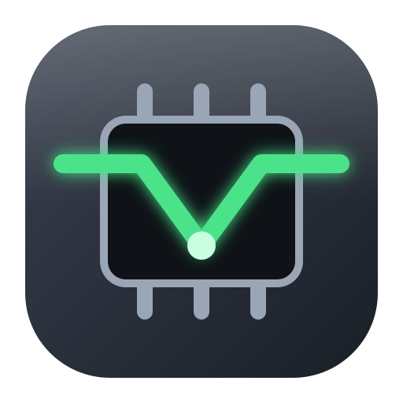
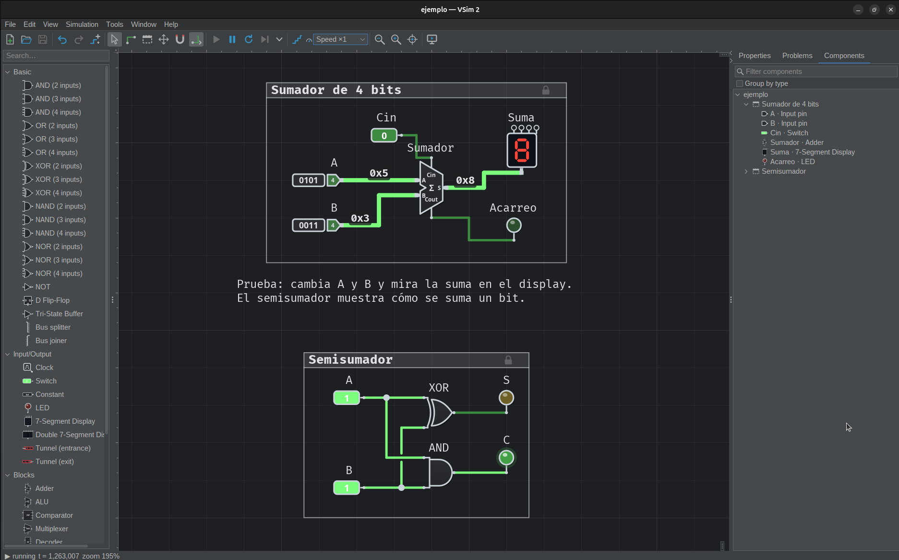

# VSim 2

Simulador de circuitos digitales: se dibuja el circuito, se simula y se ve cómo avanza cada señal.

Sus focos son **aprender y enseñar** y la **facilidad de uso**. Toma las buenas ideas que ya existen en otros
simuladores y agrega cosas que ningún otro editor de circuitos tiene: un asistente de Karnaugh que explica cada
grupo y un modo práctica que corrige, un paso a paso que muestra qué va a cambiar, cables que siguen al mover y se
ordenan solos, y un servidor MCP para conectar asistentes de IA (Claude Code, Codex u otro compatible) que arman,
prueban y presentan circuitos paso a paso en el VSim abierto.

Está hecho en Java 21 con Swing. Es la tercera versión, después de
[JCSim](https://github.com/almejo/jcsim) y [VSim](https://github.com/almejo/vsim) (ver [Historia](#historia)).

- [Funciones en detalle](docs/funciones.md): cómo funciona cada cosa, por área.
- [Cambios](CHANGELOG.md): qué se agregó y arregló, por fecha.

## Descargar y usar

Descarga de [Releases](https://github.com/almejo/vsim2/releases) el instalador de tu sistema (Windows, Linux) o el
`.jar` (necesita Java 21). Los pasos por sistema, los avisos de Windows y macOS y cómo reportar un problema están en
[Cómo instalar y probar](docs/instalar.md).

Para empezar, mira Archivo ▸ Ejemplos o abre los circuitos de [examples/](examples/).

## Historia

VSim 2 tiene una historia larga:

1. **CSim** (1987), de [Luis Mateu](https://users.dcc.uchile.cl/~lmateu/), un simulador de circuitos digitales escrito
   en C para Commodore Amiga y usado en clases de introducción.
2. **[JCSim](https://github.com/almejo/jcsim)** (2001–2004): mi reimplementación de CSim en Java, que fue mi memoria de título
   ([el documento de la memoria](docs/historia/memoria-jcsim.doc)).
3. **[VSim](https://github.com/almejo/vsim)** (2013): comencé a escribirlo como una reimplementación moderna en Java 8,
   sin las limitaciones del JCSim original, pero lo abandoné por falta de tiempo.
4. **VSim 2** (2026, este repositorio): ahora encontré el tiempo para hacer esta nueva versión, con Java 21, pensada para
   aprender y enseñar, y con un servidor MCP para conectar asistentes de IA.

## Funciones

Una línea por función; el detalle está en [docs/funciones.md](docs/funciones.md).

### Edición

- [Colocar componentes](docs/funciones/edicion.md#colocar-componentes) con un clic o arrastrándolos desde la paleta, rotándolos antes de soltarlos; también con el teclado (Alt+2, las flechas y Enter).
- [Favoritos](docs/funciones/edicion.md#favoritos): una estrella en la paleta copia el componente a «Favoritos», arriba de todo y en todas las ventanas.
- [Recientes](docs/funciones/edicion.md#recientes): los últimos 5 componentes que colocaste en la sesión, justo debajo de «Favoritos».
- [Inserción rápida](docs/funciones/edicion.md#inserción-rápida): doble clic en un espacio vacío o Insert abre un buscador de componentes que lo coloca ahí.
- [Seleccionar](docs/funciones/edicion.md#seleccionar) con clic, Mayús/Ctrl o un rectángulo que suma o quita, con cursores que dicen qué hará el clic.
- [Mover con el teclado](docs/funciones/edicion.md#mover-con-el-teclado): las flechas mueven la selección en un solo paso de deshacer.
- [Portapapeles](docs/funciones/edicion.md#portapapeles): cortar, copiar, pegar flotando y duplicar.
- [Arrastrar entre ventanas](docs/funciones/edicion.md#arrastrar-entre-ventanas) para mover o copiar entre vistas y circuitos.
- [Etiquetas, textos y Propiedades](docs/funciones/edicion.md#etiquetas-textos-y-propiedades): etiquetas que se mueven, textos libres (con la herramienta Texto de la barra: un clic y escribes; notas de varias líneas: Mayús+Enter agrega una línea al editarlas, también en Propiedades; con fondo, color de letra y borde si quieres) y un panel para editar lo seleccionado (sin nada seleccionado, el nombre del circuito, aparte del nombre de su archivo), con una tarjeta arriba, secciones, interruptores para los ajustes de sí o no y un ícono gris junto al nombre de cada ajuste común.
- [Elegir un color](docs/funciones/edicion.md#elegir-un-color) con una fila de muestras, igual para LED, marcos, túneles y notas.
- [Edición de texto en el lugar](docs/funciones/edicion.md#edición-de-texto-en-el-lugar) para etiquetas, textos, títulos y valores.
- [Marcos](docs/funciones/edicion.md#marcos) con título, color y candado, que mueven su bloque completo.
- [Notas adhesivas](docs/funciones/edicion.md#notas-adhesivas): recordatorios de texto o de tareas pegados sobre el circuito, que se pliegan con su botón –, se despegan con su ✕, se listan en la sección «Notas» del panel derecho y no salen en las imágenes salvo que lo pidas.

### Cables, buses y túneles

- [Dibujar cables](docs/funciones/cables-buses-y-tuneles.md#dibujar-cables) arrastrando desde un pin o un cable, con puntos de unión y cruces claros; los textos nombran las entradas de una compuerta desde 1 («entrada 1», «entrada 2»…).
- [Seleccionar tramos de cable](docs/funciones/cables-buses-y-tuneles.md#seleccionar-tramos-de-cable) con doble y triple clic.
- [Cables que siguen al mover](docs/funciones/cables-buses-y-tuneles.md#cables-que-siguen-al-mover): las conexiones se estiran y no se pierden; Ctrl+E lo activa o desactiva. También al cambiar en Propiedades un parámetro que mueve pines (entradas de una compuerta, tamaño de un Terminal o un Teclado).
- [Ordenar circuito](docs/funciones/cables-buses-y-tuneles.md#ordenar-circuito): alinear piezas en columnas, enderezar cables moviendo piezas, separar las piezas que se tapan (o tapan un cable ajeno), correr las que con su etiqueta tapan otra etiqueta, un texto o una nota adhesiva, y sacar los textos de encima de las piezas moviéndolos lo mínimo, quitar puntas sueltas, unir tramos y aplanar vueltas sin cambiar las conexiones.
- [Buses](docs/funciones/cables-buses-y-tuneles.md#buses) de varios bits con su valor en hexadecimal (que se puede ocultar con «Valores de los buses»), separador y unión de bus (también desde el clic derecho en un pin de bus), con [grupos de bits](docs/funciones/cables-buses-y-tuneles.md#grupos-de-bits) por pin («Bits por pin» o una ventana para bits salteados).
- [Anchos que siguen lo conectado](docs/funciones/cables-buses-y-tuneles.md#anchos-que-siguen-lo-conectado): al conectar una pieza con «Ancho (bits)» (pines, Constante, LED, Punto de parada, compuertas, registro, bloques…) toma el ancho de lo que toca, en el mismo paso de deshacer; si toca anchos distintos o no puede tomarlo, queda el aviso de anchos incompatibles (nunca elige entre anchos que no coinciden).
- [Túneles de cables](docs/funciones/cables-buses-y-tuneles.md#túneles-de-cables) que unen cables por nombre sin dibujarlos, con dirección (una entrada y sus salidas) o sin dirección (con dos triángulos «◂▸» en vez de la flecha y un aviso al cambiarla), como en Logisim.

### Componentes

- [Descripción en Propiedades](docs/funciones/componentes.md#descripción-en-propiedades): cada pieza explica qué hace y qué supone (entradas sin conectar, flanco del reloj, valores en Z, con signo…), según sus parámetros, en un recuadro que ocupa el espacio que queda en Propiedades y que también lee la IA; los componentes propios llevan la descripción que les escribas.
- [Compuertas](docs/funciones/componentes.md#compuertas) AND, OR y XOR de 2 a 8 entradas, y esas tres más el Buffer de 1 a 32 bits, con «Negar salida» para NAND, NOR, XNOR y NOT, que están en la paleta como una entrada más; el Buffer triestado también tiene ancho y «Negar salida» (el Inversor controlado); los circuitos de antes se abren igual.
- [Extensor y selector de bits](docs/funciones/componentes.md#cableado-extensor-y-selector-de-bits): el extensor cambia el ancho de un bus (rellena con ceros o con el signo, o corta) y el selector saca un grupo de bits de un bus.
- [Interruptores, LED, displays y diagramas de tiempo](docs/funciones/componentes.md#interruptores-led-displays-y-diagramas-de-tiempo) para probar los circuitos; un clic en un interruptor cambia su «Valor» (se deshace con Ctrl+Z, varios clics seguidos de una vez). El interruptor y el LED pueden tener varios bits (una fila de bits con un solo pin de bus que al rotar cambia de lado mientras la fila sigue derecha; en el interruptor, un clic cambia un bit, «Números» elige sin signo o con signo y «Valor» muestra, en un bloque, cómo se lee el número).
- [Matriz LED](docs/funciones/componentes.md#matriz-led): una grilla de 1 a 32 filas por 1 a 64 columnas de LED para dibujar letras y figuras, con entrada «Por filas» (un pin por fila) o «Barrido» (fila, datos y habilitación: cada fila conserva los datos que tuvo más tiempo mientras el barrido estaba en ella), cuatro aspectos, color, LED apagados visibles u ocultos y un brillo que se apaga; los ejemplos «Matriz LED» y «Marquesina» la muestran.
- [Pulsador](docs/funciones/componentes.md#pulsador): una entrada de 1 bit que vale 1 solo mientras lo mantienes apretado con el mouse y vuelve a 0 al soltarlo; apretarlo no es una edición, nunca queda pegado y se mueve desde su manilla.
- [Pines de entrada y de salida](docs/funciones/componentes.md#pines-de-entrada-y-de-salida) de 1 a 64 bits, con su valor escrito y editable.
- [Constante](docs/funciones/componentes.md#constante) de 1 a 32 bits en binario, octal, hexadecimal, decimal, caracteres, flotante o punto fijo.
- [Formatos de valor](docs/funciones/componentes.md#formatos-de-valor): «Mostrar como» ofrece octal, caracteres, flotante IEEE 754 (16, 32 y 64 bits) y punto fijo con «Bits de fracción», en la Constante, los pines, el Registro y el Contador, y también en las formas de onda (clic derecho en un canal), el editor de memoria (base Oct) y el tooltip de los buses (todos los formatos a la vez).
- [Memoria: RAM y ROM](docs/funciones/componentes.md#memoria-ram-y-rom): dos piezas de la paleta, de 2 a 16M palabras y de 1 a 64 bits, con `A`, `D`, `Q`, `WE`, `CS` y reloj (lectura combinacional, escritura en el flanco de bajada o de subida, a elección), bus o pines sueltos, nombre, luces `RD` (azul, al leer) y `WR` (naranja, al escribir; la ROM solo tiene `RD`), que se encienden las dos si en el mismo instante escribió y leyó y una ventana con las palabras alrededor de la dirección que se muestra u oculta con un clic en ▾ / ▸; achicarlas nunca corta el contenido. Los ejemplos «Programa en ROM» y «RAM que se llena» están en Archivo ▸ Ejemplos.
- [Memoria: editor de contenido](docs/funciones/componentes.md#memoria-editor-de-contenido): doble clic en una RAM o una ROM abre una grilla para escribir su contenido (hex, decimal o binario) con copiar y pegar, deshacer, «Llenar…», «Ir a…», «Buscar…» (Ctrl+F), importar, exportar y volcar (VSim y Logisim), valores vivos con la última lectura y escritura mientras simula, y solo lectura cuando está enlazada a un archivo.
- [Memoria: archivos enlazados](docs/funciones/componentes.md#memoria-archivos-enlazados): una RAM o una ROM enlazada a un archivo de texto (hex) que se escribe en tu editor; VSim lo recarga al guardarlo (un Ctrl+Z), si falta lo marca como problema de la pieza (sección «Problemas») y nunca lo escribe; Propiedades dice dónde está el contenido, abre el editor externo (Preferencias ▸ «Editor externo») y avisa del contenido que no se ve con «Agrandar a…»; arrastrar un `.hex` al lienzo (o Archivo ▸ Importar ▸ «Memoria desde archivo…») crea la memoria enlazada; al crear o actualizar un componente con una memoria enlazada, una casilla deja que el componente mantenga el enlace.
- [Terminal](docs/funciones/componentes.md#terminal): una pantalla de texto que el circuito escribe de a un byte en un flanco de reloj, compatible con el TTY de Logisim (7 bits) y con más: UTF-8, secuencias VT100/xterm con colores, tres perfiles (Logisim, VT100‑xterm y Teletipo) con «●» y «↺» en lo que cambias, colores y paletas ANSI, efecto de pantalla, tipografías IBM Plex Mono y VT323 incluidas, siete cursores (uno es el de Automan), la última letra marcada, globo con el código y los bytes de cada celda, una ventana propia con monitor de bytes y «Salida esperada», «Detener al recibir» un texto, sonidos, «Guardar salida» a un `.txt`, bytes como caracteres en las formas de onda, un generador de caracteres desde una ROM y una pestañita «⤡» para cambiar columnas y filas arrastrando.
- [Teclado](docs/funciones/componentes.md#teclado): una cola de bytes que tecleas desde el PC (un clic lo captura, Esc sale, Mayús+Esc envía ESC) y que el circuito lee con un flanco de reloj, como el Teclado de Logisim, con UTF-8, Enter, flechas como secuencias VT, «Texto inicial», «Terminal enlazado», «Color al escribir» con muestras, pegar y vaciar desde el clic derecho, y una pestañita «↔» para cambiar su ancho arrastrando.
- [UART 16550](docs/funciones/componentes.md#uart-16550): el puerto serie estándar con sus ocho registros en el bus de una CPU (como el de la placa «virt» de QEMU), con pantalla y teclado integrados o con pines TX y RX, FIFO de 1 o 16 bytes e interrupción.
- [Categorías de la paleta](docs/funciones/componentes.md#categorías-de-la-paleta): Compuertas, Cableado, Aritmética, Multiplexores, Secuenciales, Memoria, Entrada/Salida, Depuración y Mis componentes, en ese orden.
- [Bloques de N bits](docs/funciones/componentes.md#bloques-de-n-bits) de Aritmética y Multiplexores, y el contador: sumador, comparador, ALU, restador, negador, multiplicador, divisor, desplazador, contador de unos, multiplexor (de 2, 4 u 8 entradas), decodificador, demultiplexor, codificador con prioridad y contador (el registro y los flip-flops están en Secuenciales, abajo).
- [Secuenciales](docs/funciones/componentes.md#secuenciales): flip-flops D, JK, T y SR, todos con Q̅ y en el flanco de bajada (el SR muestra su estado prohibido; en el D, Q̅ se puede ocultar), y un registro delgado que escribe su valor en binario en grupos de 4 y en dos líneas sobre 16 bits, y que con «Disparo» carga en el flanco de bajada o de subida o funciona como un latch de nivel alto o bajo; los circuitos de antes se abren conectados y simulan igual (sus flip-flops D, sin Q̅).
- [Componentes propios](docs/funciones/componentes.md#componentes-propios) creados desde una selección (con sus marcos adentro), con librería, importación y exportación.
- [Forma de los componentes propios](docs/funciones/componentes.md#forma-de-los-componentes-propios): editor de formas con figuras (también multilíneas y polígonos, y las tres herramientas de línea se dibujan con clic o con arrastre), nodos que se agregan y se quitan con un clic, tramos curvos con dos manijas siempre a la vista que se toman directamente y nodos suaves o esquinas, plantillas (incluido el círculo), cuadrícula de fondo como la del editor principal con un botón para mostrarla u ocultarla, pines movibles con guía, textos de varias líneas escritos en el editor en el lugar, con tamaño fijo y un rectángulo de selección que los rodea, pines grandes con ayuda al pasar el mouse, colores de letra, borde, relleno y línea con la paleta de las notas, la forma predeterminada como figuras editables desde el principio, una caja que cambia de tamaño llevando lo que toca su borde y dejando centrado lo demás (o escalando todo, con Ctrl), y cables que siguen a los pines al cambiar la forma o actualizar el componente.
- [Conexiones pendientes](docs/funciones/componentes.md#conexiones-pendientes): dentro de un componente rige la regla del lienzo; un pin del componente que no llega a nada por dentro brilla en rojo y Problemas lo nombra; un cable que llega al borde de una pieza donde no hay pin (lo que deja un pin quitado) se lista también al reabrir.

### Pestañas y componentes

- [Pestañas y grupos; entrar a un componente](docs/funciones/pestanas-y-componentes.md#entrar-a-un-componente): un doble clic en una pieza de un componente propio (o su botón «Entrar ↘», «Entrar» en el clic derecho, Enter) abre el componente en una pestaña del grupo de su circuito, con los valores de esa pieza; lo que se cambia adentro cambia el componente en todo el circuito, en un solo paso de deshacer.
- [La barra de lugar](docs/funciones/pestanas-y-componentes.md#la-barra-de-lugar): cada pestaña de componente muestra su ruta («circuito › Ram › Selector 2»), con qué pieza se simulan sus valores, en cuántos lugares se usa, «Ver la pieza» y «Guardar en mi librería».
- [Árbol del circuito](docs/funciones/pestanas-y-componentes.md#árbol-del-circuito): arriba de la paleta, todas las piezas del circuito y las de adentro de cada componente, con su ícono y su nombre («Multiplexor 2»); sigue a la pestaña activa eligiendo la fila de su lugar; un clic (o Enter) lleva a la pieza (a su pestaña si hace falta), un doble clic entra a un componente, y un buscador encuentra piezas en todo el circuito; el árbol y la paleta se pliegan como acordeón y lo plegado se recuerda por ventana; Alt+1 y Alt+2 les dan el foco (o los pliegan si ya lo tienen) y se recorren con las flechas.
- [Adentro de un componente](docs/funciones/pestanas-y-componentes.md#adentro-de-un-componente-qué-cambia): la paleta no deja poner el componente dentro de sí mismo, los pines del componente toman su valor de afuera, los pines de un componente que está dentro de otro se cambian igual y los componentes que lo contienen lo siguen, «Sin valores» cuando no hay pieza que mostrar, Problemas con el camino de cada problema (F8 entra al componente), memorias con su propio contenido en cada pieza («solo Memoria 1», o «Usar para todas las piezas»), Terminales de la pieza que se ve y «Deshacer … (en Ram)», que primero lleva a la pestaña donde se hizo el paso y lo hace brillar.
- [Mirar adentro](docs/funciones/pestanas-y-componentes.md#mirar-adentro-ver-el-interior-sin-entrar): un botón con un ojo (o Alt apretada, o «Mirar adentro» arriba del clic derecho, junto a «Entrar») que muestra el interior de un componente propio en un panel flotante al pasar el mouse, con los valores de esa pieza, sin abrir su pestaña.

### Simulación y paso a paso

- [Cortocircuitos](docs/funciones/simulacion-y-paso-a-paso.md#cortocircuitos) marcados en el circuito, listados en Problemas y recorridos con F8.
- [Insignia de problemas](docs/funciones/simulacion-y-paso-a-paso.md#insignia-de-problemas): el ícono «Problemas» del panel derecho cuenta los problemas también con el panel cerrado (rojo con errores, ámbar solo con avisos) y la tarjeta del circuito dice «n problemas».
- [Paso a paso](docs/funciones/simulacion-y-paso-a-paso.md#paso-a-paso): avanzar al próximo evento, al próximo flanco de reloj (de subida o de bajada: medio ciclo) o un ciclo de reloj completo, ver qué cambió, qué flanco fue y qué viene, y reiniciar.
- [Piezas que detienen la simulación](docs/funciones/simulacion-y-paso-a-paso.md#piezas-que-detienen-la-simulación): una pieza (el Terminal con «Detener al recibir», o el [Punto de parada](docs/funciones/simulacion-y-paso-a-paso.md#punto-de-parada) de Depuración) pausa la simulación como un punto de parada y la barra de estado dice quién y por qué; la IA también lo ve en sus respuestas.
- [Mapa de memoria](docs/funciones/simulacion-y-paso-a-paso.md#mapa-de-memoria): la RAM o ROM seleccionada completa en una pestaña, con cada lectura y escritura encendida en vivo (y lo que tocó el último paso, en pausa), un mapa de calor de accesos o los valores, zoom con la rueda y «Restaurar» para una RAM.

### Formas de onda

- [Formas de onda](docs/funciones/formas-de-onda.md#formas-de-onda): un analizador lógico con canales por red, cursor, zoom y seguimiento.

### Tabla de verdad, Karnaugh y expresiones

- [Tabla de verdad](docs/funciones/tabla-de-verdad-karnaugh-y-expresiones.md#tabla-de-verdad) de lo seleccionado, de todo el circuito o de un componente, con copia y CSV.
- [Circuito desde tabla de verdad](docs/funciones/tabla-de-verdad-karnaugh-y-expresiones.md#circuito-desde-tabla-de-verdad): un asistente que simplifica con mapas de Karnaugh y arma el circuito.
- [Modo práctica de Karnaugh](docs/funciones/tabla-de-verdad-karnaugh-y-expresiones.md#modo-práctica-de-karnaugh): el alumno dibuja sus grupos y VSim los revisa.
- [Importar una tabla desde Excel o CSV](docs/funciones/tabla-de-verdad-karnaugh-y-expresiones.md#importar-una-tabla-desde-excel-o-csv) y armar su circuito.
- [Circuito desde expresiones](docs/funciones/tabla-de-verdad-karnaugh-y-expresiones.md#circuito-desde-expresiones) booleanas, simplificadas o tal como están escritas.

### Importar y exportar

- [Abrir y guardar](docs/funciones/importar-y-exportar.md#abrir-y-guardar) circuitos de VSim 2 y del VSim original; cada archivo dice que es de VSim 2 y con qué versión se guardó, es el mismo guardado en Windows, Linux o macOS, y un archivo que no se puede abrir explica por qué.
- [Exportar imagen](docs/funciones/importar-y-exportar.md#exportar-imagen) en PNG o SVG (Archivo ▸ Exportar ▸ «Imagen…»).
- [Exportar imagen de la ventana](docs/funciones/importar-y-exportar.md#exportar-imagen-de-la-ventana) en PNG (Archivo ▸ Exportar ▸ «Imagen de la ventana…»): la ventana de VSim tal como la ves, con sus diálogos abiertos, nítida a la escala de tu pantalla y sin otros programas; la IA también puede guardarla.
- [Copiar captura](docs/funciones/importar-y-exportar.md#copiar-captura) al portapapeles con un botón de la barra de herramientas (la ▾ elige «Ventana de VSim» o «Circuito visible») o con Editar ▸ «Copiar captura» (Ctrl+Mayús+C): un destello blanco y un aviso confirman lo copiado.
- [Exportar a PDF](docs/funciones/importar-y-exportar.md#exportar-a-pdf) (Archivo ▸ Exportar ▸ «PDF…») vectorial, en una hoja o en varias para pegar (cada hoja nombra a sus vecinas, y las vacías se saltan), A4, Carta, Oficio o A3, también en blanco y negro; con «Ver hojas en el circuito» sale en las hojas que ves sobre el circuito.
- [Imprimir](docs/funciones/importar-y-exportar.md#imprimir) (Ctrl+P) las mismas hojas que muestra la vista previa; si la impresora usa otro papel, primero rehace la vista previa, y avisa en verde o ámbar antes de imprimir en un papel distinto del de la impresora.
- [Hojas de impresión en el lienzo](docs/funciones/importar-y-exportar.md#hojas-de-impresión-en-el-lienzo): Ver ▸ «Mostrar hojas de impresión» (o su botón) dibuja sobre el circuito dónde caen las hojas, con su número, las vacías tenues, su cuadrícula siguiendo por todo el lienzo y lo que queda cortado (también mientras arrastras); mientras se ven quedan quietas y la impresión y el PDF las respetan.
- [Importar componentes](docs/funciones/componentes.md#componentes-propios) a la librería y [tablas de verdad desde Excel o CSV](docs/funciones/tabla-de-verdad-karnaugh-y-expresiones.md#importar-una-tabla-desde-excel-o-csv).
- [Importar un circuito de Logisim](docs/funciones/importar-y-exportar.md#importar-un-circuito-de-logisim-beta) (`.circ`, beta) desde Archivo ▸ Importar: se abre como un documento nuevo sin guardar, los circuitos del proyecto quedan como componentes propios, una ventana de progreso aparece solo si tarda más de 2 segundos, el dibujo de cada circuito queda como lo hizo Logisim (con la escala de VSim, sin limpiar los cables), los túneles llegan sin dirección, como en Logisim, y un informe lista lo que no quedó igual por circuito (diferencias reales, sin soporte, aproximado, inválido), cada aviso una vez con las piezas a las que se aplica, y un clic en una pieza la selecciona y la centra en el lienzo.
- [Exportar a Logisim](docs/funciones/importar-y-exportar.md#exportar-a-logisim-beta) (`.circ`, beta) desde Archivo ▸ Exportar: el circuito y sus componentes propios quedan como un proyecto de Logisim 2.7 que se abre con las mismas conexiones; un informe lista lo que Logisim no tiene.

### Buscar

- [Barra de búsqueda](docs/funciones/buscar.md#barra-de-búsqueda) (Ctrl+F) por etiquetas, tipos, textos, marcos, pines y túneles.
- [Buscar en el árbol del circuito](docs/funciones/buscar.md#buscar-en-el-árbol-del-circuito) con las mismas reglas, también dentro de los componentes.
- [Viaje suave de la vista](docs/funciones/buscar.md#viaje-suave-de-la-vista) hacia lo que VSim muestra y al volver a 100 %, sin resbalar hacia un lado al cambiar el zoom.

### Interfaz, preferencias y sesión

- [Pantalla de inicio](docs/funciones/interfaz-preferencias-y-sesion.md#pantalla-de-inicio): un semisumador en el lienzo, el logo y la versión mientras VSim abre, al menos 3 segundos y en la pantalla del mouse.
- [Ventanas y pestañas](docs/funciones/interfaz-preferencias-y-sesion.md#ventanas-y-pestañas): varios circuitos en pestañas de una ventana, agrupadas por circuito con su color; los grupos se arrastran enteros a otra ventana o fuera de ella, se pliegan con doble clic, y se recorren con Ctrl+Tab; Ctrl+W cierra la pestaña y Ctrl+Mayús+W la ventana; abrir un archivo lo agrega como pestaña en la ventana; un botón «+» (o doble clic en la fila vacía) abre un circuito nuevo; varias vistas del mismo circuito.
- [Dividir la vista](docs/funciones/interfaz-preferencias-y-sesion.md#dividir-la-vista) en 2 o 4 paneles del mismo circuito, como en Excel: arrastrando las pestañitas de los bordes o desde Ventana ▸ «Dividir ▸», cada panel con su zoom y una sola selección; lo que arrastras (un cable, un recuadro, piezas, un marco) sigue de un panel a otro; se recuerda por archivo, nunca en el .vsim.
- [Zoom y desplazamiento](docs/funciones/interfaz-preferencias-y-sesion.md#zoom-y-desplazamiento) con rueda, teclado, botón del medio, la herramienta Zoom (Z: un recuadro se ve en grande, un clic acerca, Alt o Mayús + clic aleja), «Ver todo el circuito» (Mayús+1), «Zoom a la selección» (Mayús+2) y un control en la barra de estado: un deslizador con 100 % al medio y el porcentaje para escribir o elegir.
- [Cuadrícula](docs/funciones/interfaz-preferencias-y-sesion.md#cuadrícula) de puntos, de líneas (cada 2 y más marcada cada 10, o con la separación que elijas: 2, 4, 5 o 10 unidades) o ninguna, con su propio color en cada esquema.
- [Ajustar](docs/funciones/interfaz-preferencias-y-sesion.md#ajustar): al mover, las piezas se alinean por bordes y centros con las vecinas, las guías o las líneas de la cuadrícula, y los puntos de un cable o las esquinas de un marco nuevo caen en las guías sin soltarse de un pin o un cable (Ctrl+Mayús+M lo apaga); mientras arrastras, un punto rojo marca cada pin o cable que quedaría tocando algo de otra red, con el nombre de los pines al lado («Cin → S»).
- [Lienzo vacío](docs/funciones/interfaz-preferencias-y-sesion.md#lienzo-vacío): un texto suave en el centro del lienzo (de cada panel, si dividiste la vista) dice cómo empezar mientras el circuito no tiene nada; desaparece al poner cualquier cosa y no sale al exportar ni imprimir.
- [Reglas y guías](docs/funciones/interfaz-preferencias-y-sesion.md#reglas-y-guías): guías que se sacan de las reglas del borde del lienzo, se guardan con el circuito y no salen al exportar.
- [Íconos, barra de herramientas y cursores](docs/funciones/interfaz-preferencias-y-sesion.md#íconos-barra-de-herramientas-y-cursores) que dicen qué hará cada cosa.
- [Panel derecho](docs/funciones/interfaz-preferencias-y-sesion.md#panel-derecho): Propiedades, Problemas, Notas y Mapa de memoria se abren desde la tira de íconos del borde o con Alt+3, Alt+4, Alt+5 y Alt+6 (también Ver ▸).
- [Modo presentación](docs/funciones/interfaz-preferencias-y-sesion.md#modo-presentación): F11 (o Ver ▸ «Modo presentación (pantalla completa)», o su botón al final de la barra de herramientas) deja el circuito solo en toda la pantalla, para proyectarlo en clases; las barras se esconden detrás de los bordes y aparecen deslizándose sobre el circuito al dejar el puntero 1 segundo en un borde (arriba el menú, las pestañas y la barra de herramientas; a la izquierda el árbol y la paleta; a la derecha el panel derecho); Esc o F11 salen y todo vuelve como estaba.
- [Atajos de teclado](docs/funciones/interfaz-preferencias-y-sesion.md#atajos-de-teclado) que se pueden cambiar.
- [Preferencias](docs/funciones/interfaz-preferencias-y-sesion.md#preferencias): tema, esquemas de colores (entre ellos «Placa», que dibuja el circuito como una placa de circuito impreso verde con pines dorados, y «Logisim» y «Chipmunk», con los colores de esos simuladores) y esquemas propios, idioma, letra y librería.
- [Acerca de VSim 2…](docs/funciones/interfaz-preferencias-y-sesion.md#acerca-de-vsim-2): versión, licencia, créditos y enlaces, con un botón para copiar la información de tu instalación.
- [Reportar un problema…](docs/funciones/interfaz-preferencias-y-sesion.md#reportar-un-problema): Ayuda ▸ «Reportar un problema…» abre en GitHub el formulario de problemas con tu versión y sistema ya puestos.
- [Sesión y recuperación](docs/funciones/interfaz-preferencias-y-sesion.md#sesión-y-recuperación): copias automáticas, recientes y continuar donde quedaste (las mismas ventanas, con sus pestañas, grupos plegados y divisiones, también al abrir VSim con un archivo, que se suma como pestaña).

### IA (MCP)

- [IA (MCP)](docs/funciones/ia-mcp.md#ia-mcp): Claude Code se conecta al VSim abierto y arma, conecta, simula y revisa circuitos en tus ventanas («arma un flip-flop D», «conviértelo en componente», «prueba su tabla de verdad»); lee y escribe el contenido de tus memorias RAM y ROM; lee, edita y simula también por dentro de un componente propio, con los valores y la memoria de una pieza (`vsim_list_places`, `vsim_open_place` y `place` en las herramientas que leen y editan); lee todas las filas de Problemas que ves (`vsim_read_problems`); lee la pantalla de un Terminal y escribe en un Teclado mientras simula (`vsim_read_terminal` y `vsim_type_text`); cada cambio es un Ctrl+Z, «Deshacer lo que hizo la IA» quita su tarea, «Detener» la para y al terminar «Ver lo que hizo» te lleva a lo que cambió. Se enciende en Herramientas ▸ «IA (MCP)…», un panel con su estado en color, Encender / Apagar / Reiniciar y qué hacer ante un error (el mismo estado y los botones también arriba de Preferencias ▸ «IA»), la barra de estado de cada ventana dice siempre «IA: apagada / escuchando / conectada / trabajando / error» con un punto de color (un clic abre el panel), y se configura una vez en Preferencias ▸ «IA» (o con un puerto solo para esta sesión: `-Dvsim.ai.port=<n>`); si Claude Code deja de responder con un paso esperando, VSim detiene la tarea a los 2 minutos.
- [Comandos de la IA](docs/funciones/ia-mcp.md#comandos-y-ayuda): en Claude Code, `/mcp__vsim__guia`, `armar`, `exponer`, `explicar`, `revisar`, `probar`, `componente` y `exportar` piden lo más común sin escribirlo entero, y `vsim://ayuda` explica qué puede y qué no hace la IA.
- [La IA en la pestaña](docs/funciones/ia-mcp.md#la-ia-en-la-pestaña): un robot chico verde en la pestaña donde la IA lee, cambia o corre (la del circuito o la de un componente), que se mece mientras trabaja (quieto con «Animación» apagada), dice su tarea al pasar el mouse y queda gris un rato al terminar; en un grupo plegado sube a la pestaña del circuito, y la lista de Ventana y «▾» lo muestran igual.
- [Presentar](docs/funciones/ia-mcp.md#presentar): con Ver ▸ «Presentar lo que hace la IA» (o pidiéndoselo a la IA) la ves armar el circuito paso a paso: una ventanita con las etapas y sus pasos (en la pestaña donde trabaja, la del robot), un globo que señala cada cambio, «Paso a paso» (cada paso en transparente hasta «Siguiente») o «De corrido» (con una pausa, elegida en la ventanita o en Ver ▸ «Ritmo de Presentar»), la vista que viaja a cada paso y cada etapa en su propio marco, de izquierda a derecha; «Deshacer etapa» etapa por etapa y, al final, «Dejar solo el resultado» cuando las etapas están separadas. La IA cuenta lo que viene como subtítulo, te pregunta en la ventanita (con botones o una respuesta corta) y, si se queda callada 20 s, VSim avisa «Claude está pensando o te preguntó algo en Claude Code».

### Ejemplos

- [Ejemplos](docs/funciones/ejemplos.md#ejemplos) clásicos en Archivo ▸ Ejemplos, que se explican solos, con «Hola, terminal» (un mensaje en una ROM que se imprime en un Terminal y un Teclado que se repite en la misma pantalla), «Punto de parada» (un contador que se detiene solo en 9), «Formatos de valor» (una cuenta vista en binario, hexa, octal, decimal, con signo, carácter y punto fijo, y una Constante en flotante), «Matriz LED» (un corazón en una matriz de 8 × 8) y «Marquesina» (un texto que pasa por una matriz).

## Para desarrolladores

### Requisitos para compilar

- JDK 21. Gradle no hace falta instalarlo: se usa `./gradlew`, que lo descarga.

### Construir y ejecutar

    ./gradlew :ui:run                                              # el editor
    ./gradlew :ui:run --args="../examples/sumador-y-semisumador.vsim"  # abrir un archivo (rutas relativas a ui/)
    ./gradlew :ui:run -PvsimLanguage=en                            # la interfaz en inglés

Jar ejecutable, con todas las dependencias adentro:

    ./gradlew :ui:executableJar          # deja ui/build/libs/vsim2-<versión>.jar
    java -jar ui/build/libs/vsim2-<versión>.jar

`./gradlew check` construye el jar y verifica su manifiesto y contenido (`:ui:executableJarTest`).

Instaladores con su propio Java (deb y rpm en Linux, msi y zip portátil en Windows, dmg en macOS):

    ./gradlew :ui:nativePackages         # deja los de este sistema en ui/build/distribution/
    ./gradlew :ui:packagedRuntimeCheck   # comprueba que el Java incluido basta para VSim

Requisitos y detalles en [packaging/README.md](packaging/README.md). Una etiqueta `vX.Y` arma todos los instaladores y deja la release en borrador ([Publicar una versión](packaging/README.md#publicar-una-versión)).

### Pruebas

    ./gradlew test                            # todas las pruebas (core, automation, mcp y ui)
    ./gradlew test :ui:executableJarTest      # lo que se corre antes de cada commit (también revisa el jar)

Cómo se regeneran los ejemplos y las reglas del código: [Para desarrolladores](docs/funciones/para-desarrolladores.md#para-desarrolladores)
y [conventions.md](conventions.md).

Licencia: [GPL 3.0](LICENSE). Las tipografías IBM Plex Mono y VT323 usan la licencia SIL OFL 1.1 (textos en `ui/src/main/resources/fonts/`).
