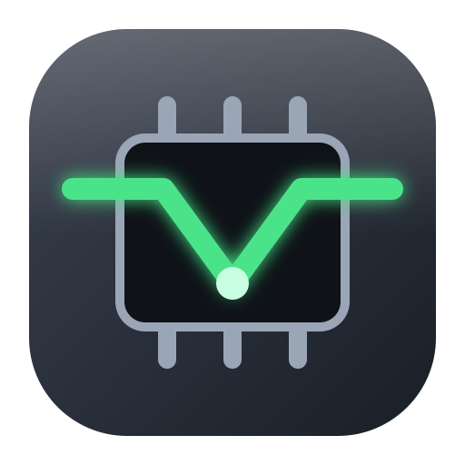
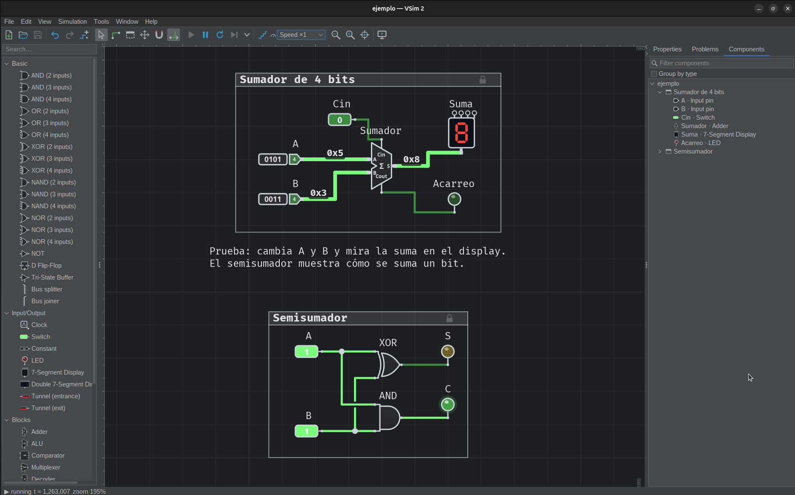

# VSim 2

Simulador de circuitos digitales: se dibuja el circuito, se simula y se ve cómo avanza cada señal.

Sus focos son **aprender y enseñar** y la **facilidad de uso**. Toma las buenas ideas que ya existen en otros
simuladores y agrega cosas que ningún otro editor de circuitos tiene: un asistente de Karnaugh que explica cada
grupo y un modo práctica que corrige, un paso a paso que muestra qué va a cambiar, cables que siguen al mover y se
ordenan solos, y un servidor MCP para conectar asistentes de IA (Claude Code, Codex u otro compatible) que arman,
prueban y presentan circuitos paso a paso en el VSim abierto.

Está hecho en Java 21 con Swing. Es la tercera versión, después de
[JCSim](https://github.com/almejo/jcsim) y [VSim](https://github.com/almejo/vsim) (ver [Historia](#historia)).

- [Funciones en detalle](docs/funciones.md): cómo funciona cada cosa, por área.
- [Cambios](CHANGELOG.md): qué se agregó y arregló, por fecha.

## Descargar y usar

1. Instala **OpenJDK 21** (en Linux, el paquete `openjdk-21-jre` de tu distribución; en Windows y macOS, el
   instalador de OpenJDK 21 que prefieras).
2. Descarga `vsim2-<versión>.jar` de la versión más nueva en [Releases](https://github.com/almejo/vsim2/releases).
3. Ábrelo con doble clic, o en una terminal con `java -jar vsim2-<versión>.jar`.

Para empezar, mira Archivo ▸ Ejemplos o abre los circuitos de [examples/](examples/).

## Historia

VSim 2 tiene una historia larga:

1. **CSim** (1987), de [Luis Mateu](https://users.dcc.uchile.cl/~lmateu/), un simulador de circuitos digitales escrito
   en C para Commodore Amiga y usado en clases de introducción.
2. **[JCSim](https://github.com/almejo/jcsim)** (2001–2004): mi reimplementación de CSim en Java, que fue mi memoria de título
   ([el documento de la memoria](docs/historia/memoria-jcsim.doc)).
3. **[VSim](https://github.com/almejo/vsim)** (2013): comencé a escribirlo como una reimplementación moderna en Java 8,
   sin las limitaciones del JCSim original, pero lo abandoné por falta de tiempo.
4. **VSim 2** (2026, este repositorio): ahora encontré el tiempo para hacer esta nueva versión, con Java 21, pensada para
   aprender y enseñar, y con un servidor MCP para conectar asistentes de IA.

## Funciones

Una línea por función; el detalle está en [docs/funciones.md](docs/funciones.md).

### Edición

- [Colocar componentes](docs/funciones.md#colocar-componentes) con un clic o arrastrándolos desde la paleta, rotándolos antes de soltarlos.
- [Favoritos](docs/funciones.md#favoritos): una estrella en la paleta copia el componente a «Favoritos», arriba de todo y en todas las ventanas.
- [Recientes](docs/funciones.md#recientes): los últimos 5 componentes que colocaste en la sesión, justo debajo de «Favoritos».
- [Inserción rápida](docs/funciones.md#inserción-rápida): doble clic en un espacio vacío o Insert abre un buscador de componentes que lo coloca ahí.
- [Seleccionar](docs/funciones.md#seleccionar) con clic, Mayús/Ctrl o un rectángulo que suma o quita, con cursores que dicen qué hará el clic.
- [Mover con el teclado](docs/funciones.md#mover-con-el-teclado): las flechas mueven la selección en un solo paso de deshacer.
- [Portapapeles](docs/funciones.md#portapapeles): cortar, copiar, pegar flotando y duplicar.
- [Arrastrar entre ventanas](docs/funciones.md#arrastrar-entre-ventanas) para mover o copiar entre vistas y circuitos.
- [Etiquetas, textos y Propiedades](docs/funciones.md#etiquetas-textos-y-propiedades): etiquetas que se mueven, textos libres (notas de varias líneas: Mayús+Enter agrega una línea al editarlas, también en Propiedades; con fondo, color de letra y borde si quieres) y un panel para editar lo seleccionado.
- [Elegir un color](docs/funciones.md#elegir-un-color) con una fila de muestras, igual para LED, marcos, túneles y notas.
- [Edición de texto en el lugar](docs/funciones.md#edición-de-texto-en-el-lugar) para etiquetas, textos, títulos y valores.
- [Marcos](docs/funciones.md#marcos) con título, color y candado, que mueven su bloque completo.

### Cables, buses y túneles

- [Dibujar cables](docs/funciones.md#dibujar-cables) arrastrando desde un pin o un cable, con puntos de unión y cruces claros.
- [Seleccionar tramos de cable](docs/funciones.md#seleccionar-tramos-de-cable) con doble y triple clic.
- [Cables que siguen al mover](docs/funciones.md#cables-que-siguen-al-mover): las conexiones se estiran y no se pierden.
- [Ordenar cables](docs/funciones.md#ordenar-cables): quitar puntas sueltas, unir tramos y aplanar vueltas sin cambiar las conexiones.
- [Buses](docs/funciones.md#buses) de varios bits con su valor en hexadecimal, separador y unión de bus.
- [Túneles de cables](docs/funciones.md#túneles-de-cables) que unen cables por nombre sin dibujarlos.

### Componentes

- [Interruptores, LED, displays y diagramas de tiempo](docs/funciones.md#interruptores-led-displays-y-diagramas-de-tiempo) para probar los circuitos.
- [Pines de entrada y de salida](docs/funciones.md#pines-de-entrada-y-de-salida) de 1 a 64 bits, con su valor escrito y editable.
- [Constante](docs/funciones.md#constante) de 1 a 32 bits en binario, hexadecimal o decimal.
- [Bloques](docs/funciones.md#bloques) de N bits: sumador, ALU, comparador, multiplexor, decodificador, registro y contador.
- [Componentes propios](docs/funciones.md#componentes-propios) creados desde una selección, con librería, importación y exportación.

### Simulación y paso a paso

- [Cortocircuitos](docs/funciones.md#cortocircuitos) marcados en el circuito, listados en Problemas y recorridos con F8.
- [Paso a paso](docs/funciones.md#paso-a-paso): avanzar al próximo evento o flanco de reloj, ver qué cambió y qué viene, y reiniciar.

### Formas de onda

- [Formas de onda](docs/funciones.md#formas-de-onda): un analizador lógico con canales por red, cursor, zoom y seguimiento.

### Tabla de verdad, Karnaugh y expresiones

- [Tabla de verdad](docs/funciones.md#tabla-de-verdad) de lo seleccionado, de todo el circuito o de un componente, con copia y CSV.
- [Circuito desde tabla de verdad](docs/funciones.md#circuito-desde-tabla-de-verdad): un asistente que simplifica con mapas de Karnaugh y arma el circuito.
- [Modo práctica de Karnaugh](docs/funciones.md#modo-práctica-de-karnaugh): el alumno dibuja sus grupos y VSim los revisa.
- [Importar una tabla desde Excel o CSV](docs/funciones.md#importar-una-tabla-desde-excel-o-csv) y armar su circuito.
- [Circuito desde expresiones](docs/funciones.md#circuito-desde-expresiones) booleanas, simplificadas o tal como están escritas.

### Importar y exportar

- [Abrir y guardar](docs/funciones.md#abrir-y-guardar) circuitos de VSim 2 y del VSim original; cada archivo dice que es de VSim 2 y con qué versión se guardó.
- [Exportar imagen](docs/funciones.md#exportar-imagen) en PNG o SVG.
- [Exportar a PDF](docs/funciones.md#exportar-a-pdf) vectorial, en una hoja o en varias para pegar, A4, Carta, Oficio o A3, también en blanco y negro.
- [Importar componentes](docs/funciones.md#componentes-propios) a la librería y [tablas de verdad desde Excel o CSV](docs/funciones.md#importar-una-tabla-desde-excel-o-csv).

### Buscar

- [Barra de búsqueda](docs/funciones.md#barra-de-búsqueda) (Ctrl+F) por etiquetas, tipos, textos, marcos, pines y túneles.
- [Filtrar el árbol de componentes](docs/funciones.md#filtrar-el-árbol-de-componentes) con las mismas reglas.
- [Viaje suave de la vista](docs/funciones.md#viaje-suave-de-la-vista) hacia lo que VSim muestra y al volver a 100 %, sin resbalar hacia un lado al cambiar el zoom.

### Interfaz, preferencias y sesión

- [Ventanas y vistas](docs/funciones.md#ventanas-y-vistas): varias vistas del mismo circuito.
- [Dividir la vista](docs/funciones.md#dividir-la-vista) en 2 o 4 paneles del mismo circuito, como en Excel: arrastrando las pestañitas de los bordes o desde Ventana ▸ «Dividir ▸», cada panel con su zoom y una sola selección; lo que arrastras (un cable, un recuadro, piezas, un marco) sigue de un panel a otro; se recuerda por archivo, nunca en el .vsim.
- [Zoom y desplazamiento](docs/funciones.md#zoom-y-desplazamiento) con rueda, teclado, botón del medio, la herramienta Zoom (Z: un recuadro se ve en grande, un clic acerca, Alt o Mayús + clic aleja), «Ver todo el circuito» (Mayús+1), «Zoom a la selección» (Mayús+2) y un control en la barra de estado: un deslizador con 100 % al medio y el porcentaje para escribir o elegir.
- [Cuadrícula](docs/funciones.md#cuadrícula) de puntos, de líneas (cada 2 y más marcada cada 10, o con la separación que elijas: 2, 4, 5 o 10 unidades) o ninguna, con su propio color en cada esquema.
- [Ajustar](docs/funciones.md#ajustar): al mover, las piezas se alinean por bordes y centros con las vecinas, las guías o las líneas de la cuadrícula, y los puntos de un cable o las esquinas de un marco nuevo caen en las guías sin soltarse de un pin o un cable (Ctrl+Mayús+M lo apaga); mientras arrastras, un punto rojo marca cada pin o cable que quedaría tocando algo de otra red, con el nombre de los pines al lado («Cin → S»).
- [Reglas y guías](docs/funciones.md#reglas-y-guías): guías que se sacan de las reglas del borde del lienzo, se guardan con el circuito y no salen al exportar.
- [Íconos, barra de herramientas y cursores](docs/funciones.md#íconos-barra-de-herramientas-y-cursores) que dicen qué hará cada cosa.
- [Atajos de teclado](docs/funciones.md#atajos-de-teclado) que se pueden cambiar.
- [Pestaña Componentes](docs/funciones.md#pestaña-componentes): el árbol del circuito con sus valores.
- [Preferencias](docs/funciones.md#preferencias): tema, esquemas de colores (entre ellos «Placa», que dibuja el circuito como una placa de circuito impreso verde con pines dorados) y esquemas propios, idioma, letra y librería.
- [Sesión y recuperación](docs/funciones.md#sesión-y-recuperación): copias automáticas, recientes y continuar donde quedaste.

### IA (MCP)

- [IA (MCP)](docs/funciones.md#ia-mcp): Claude Code se conecta al VSim abierto y arma, conecta, simula y revisa circuitos en tus ventanas («arma un flip-flop D», «conviértelo en componente», «prueba su tabla de verdad»); cada cambio es un Ctrl+Z, «Deshacer lo que hizo la IA» quita su tarea, «Detener» la para y al terminar «Ver lo que hizo» te lleva a lo que cambió. Se enciende en Herramientas ▸ «IA (MCP)…», un panel con su estado en color, Encender / Apagar / Reiniciar y qué hacer ante un error (el mismo estado y los botones también arriba de Preferencias ▸ «IA»), la barra de estado de cada ventana dice siempre «IA: apagada / escuchando / conectada / trabajando / error» con un punto de color (un clic abre el panel), y se configura una vez en Preferencias ▸ «IA» (o con un puerto solo para esta sesión: `-Dvsim.ai.port=<n>`); si Claude Code deja de responder con un paso esperando, VSim detiene la tarea a los 2 minutos.
- [Comandos de la IA](docs/funciones.md#comandos-y-ayuda): en Claude Code, `/mcp__vsim__guia`, `armar`, `exponer`, `explicar`, `revisar`, `probar`, `componente` y `exportar` piden lo más común sin escribirlo entero, y `vsim://ayuda` explica qué puede y qué no hace la IA.
- [Presentar](docs/funciones.md#presentar): con Ver ▸ «Presentar lo que hace la IA» (o pidiéndoselo a la IA) la ves armar el circuito paso a paso: una ventanita con las etapas y sus pasos, un globo que señala cada cambio, «Paso a paso» (cada paso en transparente hasta «Siguiente») o «De corrido» (con una pausa, elegida en la ventanita o en Ver ▸ «Ritmo de Presentar»), la vista que viaja a cada paso y cada etapa en su propio marco, de izquierda a derecha; «Deshacer etapa» etapa por etapa y, al final, «Dejar solo el resultado» cuando las etapas están separadas. La IA cuenta lo que viene como subtítulo, te pregunta en la ventanita (con botones o una respuesta corta) y, si se queda callada 20 s, VSim avisa «Claude está pensando o te preguntó algo en Claude Code».

### Ejemplos

- [Ejemplos](docs/funciones.md#ejemplos) clásicos en Archivo ▸ Ejemplos, que se explican solos.

## Para desarrolladores

### Requisitos para compilar

- JDK 21. Gradle no hace falta instalarlo: se usa `./gradlew`, que lo descarga.

### Construir y ejecutar

    ./gradlew :ui:run                                              # el editor
    ./gradlew :ui:run --args="../examples/sumador-y-semisumador.vsim"  # abrir un archivo (rutas relativas a ui/)
    ./gradlew :ui:run -PvsimLanguage=en                            # la interfaz en inglés

Jar ejecutable, con todas las dependencias adentro:

    ./gradlew :ui:executableJar          # deja ui/build/libs/vsim2-<versión>.jar
    java -jar ui/build/libs/vsim2-<versión>.jar

`./gradlew check` construye el jar y verifica su manifiesto y contenido (`:ui:executableJarTest`).

Demo de consola (simula un circuito sin interfaz):

    ./gradlew :core:run --args="../examples/vsim1-sumador-4-bits.json"

### Pruebas

    ./gradlew test                            # todas las pruebas (core, automation, mcp y ui)
    ./gradlew test :ui:executableJarTest      # lo que se corre antes de cada commit (también revisa el jar)

Cómo se regeneran los ejemplos y las reglas del código: [Para desarrolladores](docs/funciones.md#para-desarrolladores)
y [conventions.md](conventions.md).

Licencia: [GPL 3.0](LICENSE).
